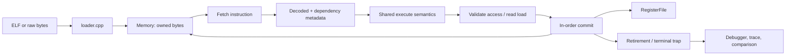

# A readable RV32I simulator

This C++17 teaching and portfolio project runs the same bare-metal RV32I program in two ways. The **functional model** finishes one instruction per step. The **pipeline model** overlaps instructions in five stages and models data stalls, forwarding, and branch flushes. Both publish the same architectural commit events, making differences easy to find.

The core is deliberately small: explicit fixed-width values, owned byte RAM, a decoder, shared instruction semantics, a loader, and two schedulers. It includes an interactive debugger, text/JSONL traces, JSON statistics, eight prebuilt demonstrations, focused tests, and CI configuration. It does not model a commercial processor or certify ISA compliance.

## Quick start

Requires CMake 3.20+, a C++17 compiler, and Python 3.10+. No RISC-V compiler is needed to run the supplied binaries.

Linux/WSL is the primary workflow for GNU cross-compilation and optional Spike validation:

```sh
cmake -S . -B build -DCMAKE_BUILD_TYPE=Debug
cmake --build build --parallel 2
ctest --test-dir build --output-on-failure
./build/rvsim --program demos/prebuilt/fibonacci.elf --format elf
```

Expected result: `a0 = 0x00000037 unsigned=55 signed=55`. EBREAK at the commit boundary signals normal completion.

Windows PowerShell with GCC and Ninja:

```powershell
cmake -S . -B build -G Ninja -DCMAKE_CXX_COMPILER=g++ -DCMAKE_BUILD_TYPE=Debug
cmake --build build
ctest --test-dir build --output-on-failure
.\build\rvsim.exe --program demos/prebuilt/fibonacci.elf --format elf
```

Windows with Visual Studio 2022:

```powershell
cmake -S . -B build-msvc -G "Visual Studio 17 2022" -A x64
cmake --build build-msvc --config Debug --parallel 2
ctest --test-dir build-msvc -C Debug --output-on-failure
.\build-msvc\Debug\rvsim.exe --program demos/prebuilt/fibonacci.elf --format elf
```

Compare forwarding (use `.\build\rvsim.exe` on Windows):

```sh
./build/rvsim --program demos/prebuilt/alu_chain.elf --format elf --model pipeline --forwarding on --trace chain.txt --stats on.json
./build/rvsim --program demos/prebuilt/alu_chain.elf --format elf --model pipeline --forwarding off --stats off.json
python scripts/run_demos.py --sim build/rvsim
```

The supplied ALU chain produces 7 in both cases: 9 modeled cycles with forwarding, 15 without. The pipeline includes fill, drain, and the terminal EBREAK cycle in that count. These are simulated cycles, not host execution speed.

## What is supported

RV32I integer arithmetic, logical/shift operations, all base load/store widths, six conditional branches, JAL/JALR, LUI/AUIPC, ordinary FENCE, ECALL, and EBREAK. Instruction alignment is four bytes. Data accesses must be naturally aligned. Arithmetic wraps modulo 2^32. RAM is little-endian, zero-based, shared by independent instruction/data ports, with full-access bounds checks.

The environment is a single hart with flat RAM and no operating system. Reset gives zero registers and the image entry PC; assembly/C startup establishes its own stack. ELF input is static little-endian ELF32 ET_EXEC for RISC-V with flags zero; PT_LOAD segments initialize RAM and BSS. Raw input defaults to load/entry 0x1000. All eight demos have both formats.

Extensions M/A/C/F/D, CSR instructions, FENCE.I/TSO, privileged instructions, interrupts, caches, virtual memory, devices, Linux syscalls, dynamic linking, and coherent self-modifying code are outside scope. ECALL is a terminal simulation fault. Ordinary FENCE has no work in this single-hart uncached model. Pipeline bypasses and timing are specified in [Architecture](docs/ARCHITECTURE.md).

## Data flow



The functional scheduler runs this path for one instruction. The pipeline scheduler separates it with current/next IF/ID, ID/EX, EX/MEM, and MEM/WB latches; `tick()` applies one consistent latch update.

## Guides

- [Start here: registers, every supported instruction, and a code-reading walkthrough](docs/INSTRUCTION_REFERENCE.md)
- [Architecture and timing contract](docs/ARCHITECTURE.md)
- [User guide: CLI, debugging, traces, exit codes](docs/USER_GUIDE.md)
- [Writing assembly and freestanding C](docs/WRITING_PROGRAMS.md)
- [Demonstrations and checked results](docs/DEMOS.md)
- [Sharing a ZIP and running it on a friend's computer](docs/SHARING.md)
- [Tests, differential checking, pinned Spike setup](docs/TESTING.md)
- [Measured benchmarks and regeneration](docs/BENCHMARKS.md)
- [Adding instructions](docs/ADDING_INSTRUCTIONS.md)
- [Upstream, references, licensing, and authorship](docs/UPSTREAM.md)
- [Interview explanation and project summary](docs/PROJECT_SUMMARY.md)

## Code formatting

C/C++ uses four-space indentation, explicit control-flow braces, and a 100-column limit defined in
[.clang-format](.clang-format). Blank lines separate meaningful steps inside functions: validation,
processing, state changes, and results. Related declarations and short calls stay together; arguments
wrap only when they need the space. Empty constructors can keep their braces on one line.
Python uses Black with the same line
limit in [pyproject.toml](pyproject.toml); CMake uses two spaces. [.editorconfig](.editorconfig) records
editor indentation, UTF-8, and line-ending defaults.

With clang-format 19 available, install the optional formatter packages and run:

```sh
python -m pip install -r requirements-format.txt
python scripts/format_code.py
python scripts/format_code.py --check
```

The helper automatically finds Visual Studio's bundled clang-format on Windows, or accepts
`--clang-format PATH`. This workspace also has the Python formatters in the ignored
`.tools/formatters` directory, which the helper detects. Formatting tools are optional and are not
needed to build or run the simulator. The formatting pass preserves the instruction/timing contract;
the normal simulator and demo tests are rerun after changes.

## Verification status

Actual host testing: Windows x64, GCC/WinLibs 16.2.0, MSVC 19.44.35225 / Visual Studio 2022, Ninja 1.13.2, CMake 4.3.1, Python 3.14.2. GCC Debug, a fresh GCC Release build, and MSVC Debug each passed all four suites. Prebuilt demos were built and byte-for-byte rebuilt using Zig 0.14.1's Clang/LLD RISC-V toolchain; exact commands and hashes are in [provenance.json](demos/prebuilt/provenance.json). See the [delivery validation record](docs/VALIDATION.md) for commands, file inventory, and limitations.

Linux/WSL commands and sanitizer jobs are supplied, but their execution is not claimed from this Windows host. Spike is **not run** here; the real adapter and setup scripts are supplied. CI workflow creation does not mean hosted CI has passed. The specification and Spike are credited in [Upstream](docs/UPSTREAM.md); the starting workspace contained no upstream code or repository.
